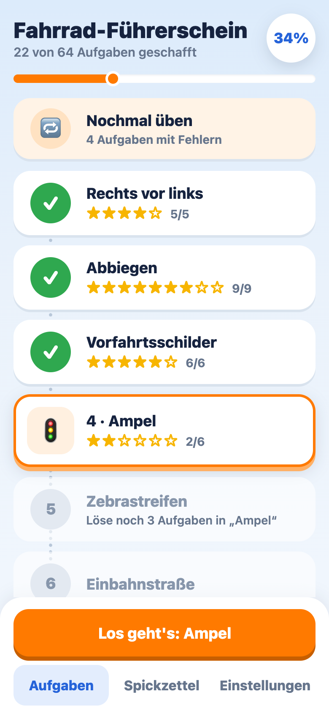
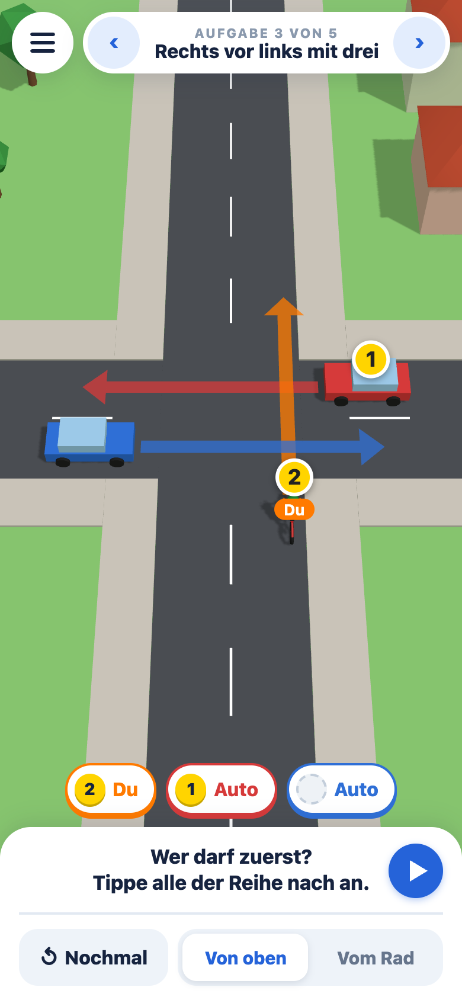
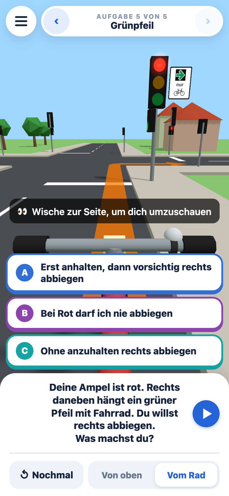
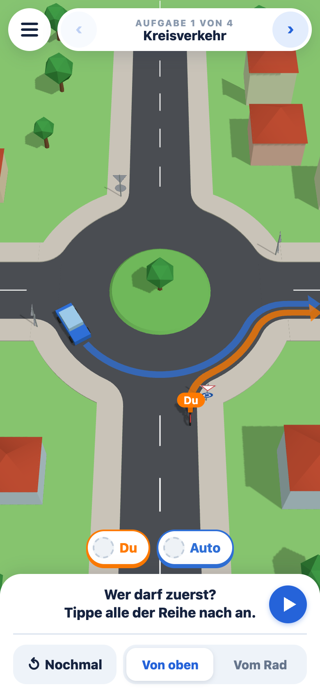
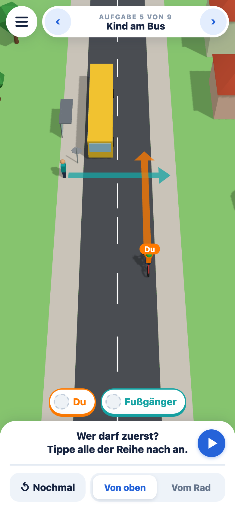
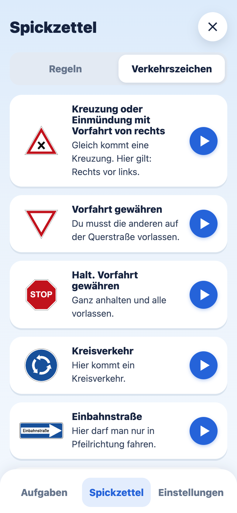

# Fahrrad-Führerschein 3D

A German 3D learning app for primary school kids (grade 3/4) preparing for the cycling test (Radfahrprüfung):
who goes first at a junction, traffic signs, lights, zebra crossings, turning left (directly or indirectly),
one-way streets, roundabouts, and special places like a driveway, a bus stop or a Spielstraße.
Kids tap the road users in the right order or pick an answer, watch the scene play out, and get the rule
explained in child-friendly German, with a source in the StVO.

- 10 levels, the last one a mixed exam; the next level opens at 80 % solved
- order tasks play out; a wrong order freezes just before a crash ("Achtung!")
- seen from above or from the bike, with a look over the shoulder
- "Nochmal üben" repeats the tasks answered wrong; a cheat sheet with every rule and sign
- everything can be read aloud; progress stays on the device, no account

**Live:** https://fahrrad.michikrug.de (works offline once loaded, can be added to the home screen)

<p>
  
  
  
  
  
  
  
</p>

Built with Vite, TypeScript and three.js. All 3D models, traffic signs and sounds are generated in code; no asset files.
Detailed sign pictograms use the official artwork from Wikimedia Commons (public domain as official works).

## Develop

```sh
npm install
npm run dev     # dev server, also reachable from phones on the same network
npm run check   # type check + tests (bun test)
```

Tasks and rules live in `src/content/` as plain data. GitHub Actions runs the same check and a build on every
push and pull request; Dependabot keeps the actions and npm packages current. Notes for coding agents: [AGENTS.md](AGENTS.md).

## Deploy

Static files on Cloudflare Workers (see `wrangler.jsonc`):

```sh
npm run build && npx wrangler deploy
```

## Licence

MIT, see [LICENSE](LICENSE). Rules are paraphrased from the StVO; this app does not replace the official
teaching material of your school or the Verkehrswacht.
